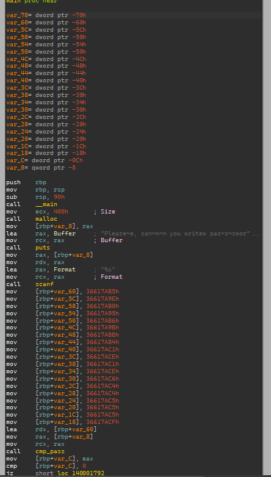
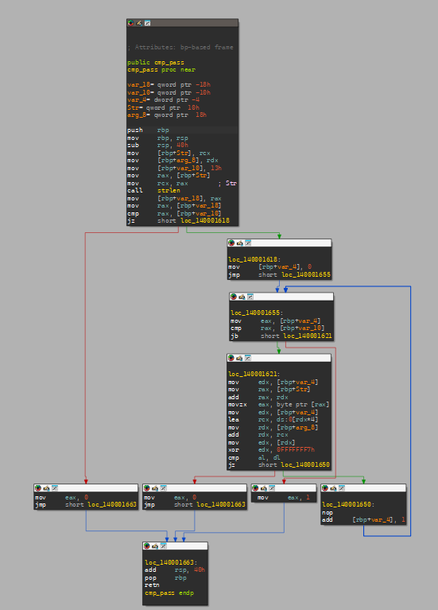

[AlmazVip](https://crackmes.one/user/AlmazVip)'s Really Very Easy is a challenge on crackmes.one.

## Process

In this challenge, we have a PE executable. For cracking this one, I used IDA, but any other disassembler would do a great job.

After taking a look at the code, this block has some parts to notice, like those `mov` instructions and the `cmp_pass` call.





If we decompile them, we can see that there is an array and an input password, and they are both being passed into the `cmp_pass` function.

![Decompiled main: v3[0] to v3[18] are assigned constants like 912358069, then cmp_pass(v5, v3) decides the result](./images/almazvip-main-decompiled.png)

In the `cmp_pass` function, we can see something like this:

![Decompiled cmp_pass: returns 0 unless strlen(a1) is 19, then checks a1[i] equals the low byte of a2[i] XOR 0xF7 for every i](./images/almazvip-cmp-pass-decompiled.png)

It is clear that the input must be a string of length 19. The loop XORs the first byte of the array's i-th element with `0xF7` and compares it with the i-th character of the input string. So we can write a simple C program to undo it:

```c
#include <stdio.h>

int main() {
	int numbers[19] = {
		912358069, 912358046, 912358064, 912358037, 912358070,
		912358043, 912358075, 912358020, 912358081, 912358094,
		912358081, 912358094, 912358086, 912358084, 912358084,
		912358085, 912358085, 912358085, 912358095,
	};
	for (int i = 0; i < 19; ++i)
		printf("%c", numbers[i] ^ 0xf7);
	printf("\n");
	return 0;
}
```

If we run this, we get the expected password: `BiGbAlLs69691332228`.

## Next

I need to be able to understand loops without decompiling. To read them straight from the assembly, I need more experience.
