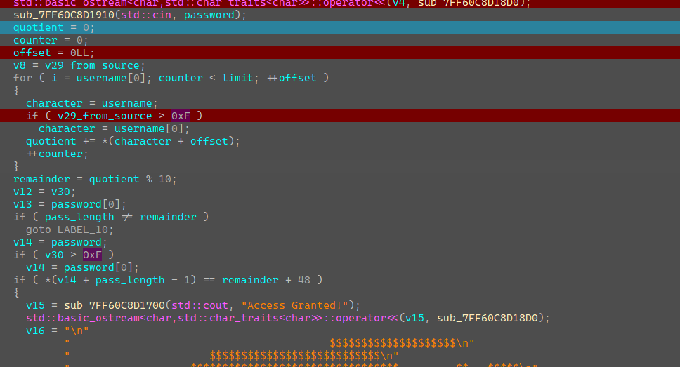

[Chriswerwerwer](https://crackmes.one/user/Chriswerwerwer)'s Hyperion is a challenge on crackmes.one.

## Cracking the logic

First, open any decompiler (IDA, Ghidra, etc.). Debug and find this part of the decompilation (I named the variables myself):

You'll find it right under the "Enter your key" text. For your own ease, name the other variables you need, like username and password.

Notice the loop: it adds up the ASCII value of every character in the username and stores it in the variable I named `quotient`. The remainder of `quotient / 10` is stored in `remainder`. Next, the password length must be the same as `remainder`, otherwise it's incorrect.

For the next check, `v14` is simply a pointer to the first character of the password, so `*(v14 + x)` is the same as `v14[x]`. Here `x` is `pass_length - 1`, so `v14[pass_length - 1]` must equal `'0' + remainder`: the ASCII code of the remainder digit.

## Generating credentials

Now that we understand the logic, we just need a valid pair. You can write a small generator, for example a Python script that makes a username with a given sum mod 10 and a password of matching length and last digit. By hand:

- Username: `ABCDEFGH` (sum = 548, and 548 mod 10 = 8)
- Password: `12345678` (only the length 8 and the last digit 8 matter; the rest can be anything)

## Next

I couldn't solve this one with x64dbg alone, so I need to get better at reading assembly directly.
