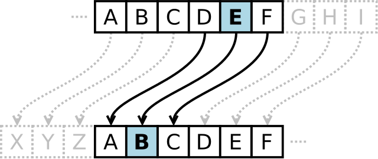
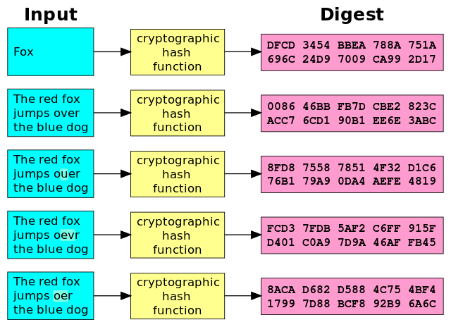

<small lang="en">Written in Bangla for Tachyon, a student science magazine, while I was in grade 12.</small>

প্রাচীনকাল থেকেই তথ্যের গোপনীয়তার দিকে মানুষের ভালো নজর ছিল। যুদ্ধের সময় কোনো বার্তা, কিংবা গোপনভাবে কোনো কিছু পাঠানোর জন্য নিরাপত্তার প্রয়োজন ছিল। এজন্য মানুষ এসব তথ্যের সুরক্ষার জন্য অভিনব কিছু উপায় আবিষ্কার করে আসছে, যাতে তার গোপনীয়তা সুরক্ষিত থাকে। সময়ের তালে তালে আধুনিক যুগে এসেও আবিষ্কৃত হয়েছে সময়োপযোগী পন্থা। এখন ইন্টারনেটের প্রায় সব জায়গায়ই গণিতনির্ভর এর পন্থার ব্যবহার হয়, কিন্তু তা কিভাবে?

## ক্রিপ্টোগ্রাফি কী?
ক্রিপ্টোগ্রাফি শব্দটি এসেছে 'ক্রিপ্টোস', যার অর্থ 'লুকায়িত' ও 'গ্রাফিন' শব্দ থেকে, যা দিয়ে কোনোরূপ পড়াশুনাকে বোঝায়। এটি কম্পিউটার সায়েন্সের নিরাপত্তা বিষয়ক একটি শাখা, যাতে তথ্য গোপন করার বিভিন্ন উপায় সম্পর্কে গবেষণা করা হয়।

গ্রিক ও রোমান, উভয় সাম্রাজ্যেই কিছু নিজস্ব পদ্ধতি ব্যবহৃত হতো। এর মধ্যে জুলিয়াস সিজারের সিজার সাইফার (Caesar Cipher) উল্লেখযোগ্য। সাইফার বলতে বোঝায় কিছু ধাপ বা সোজা কথায় অ্যালগরিদম, যার মাধ্যমে বিশেষ একটি প্রক্রিয়ায় এনক্রিপশন বা ডিক্রিপশন করা যায়। এনক্রিপ্ট করা বলতে তালাবদ্ধ করাকে বোঝায়, আর ডিক্রিপ্ট করা বলতে তালা খোলা বোঝায়। এনক্রিপ্ট করা টেক্সটকে বলে সাইফারটেক্সট । এরকম আরোও অনেক সাইফার রয়েছে, যার একটা লিস্ট উইকিপিডিয়ায় পেয়ে যাবেন। যেকোনো সাইফার এর নিয়ন্ত্রণ করার জন্য একটি চাবি থাকে। চাবি হলো একটি লিখিত অংশ যা দিয়ে এনক্রিপ্ট করা বা তালাবদ্ধ তথ্যকে ডিক্রিপ্ট করা বা তালা খোলা যায়। সাইফার এর সাথে বলতে হয় ক্রিপ্টোসিস্টেম এর ব্যাপারে। এটি আসলে কিছুই না বরং একটি নির্দিষ্ট পদ্ধতির চাবি তৈরি, এনক্রিপশন ও ডিক্রিপশন এর অ্যালগরিদম এর সমষ্টি। হ্যাঁ, এখন হয়ত বুঝতেই পারছেন যে পূর্বে উল্লিখিত সিজার সাইফারও একটি ক্রিপ্টোসিস্টেম।

<small>ছবি: Matt Crypto, Wikimedia Commons (পাবলিক ডোমেইন)</small>

## হ্যাশিং ও এর ব্যবহার
হ্যাশ ফাংশন নামটা কখনো শুনেছেন? হ্যাশিং করা বলতে বোঝায় কোনো তথ্যকে নির্দিষ্ট দৈর্ঘ্যের বিশেষ কোডে রূপান্তরিত করা, 

যা স্বাভাবিকভাবে কোনো মানুষ বুঝতে পারবে না। উদাহরণস্বরূপ, এমন কোনো হ্যাশ ফাংশন, যা কিনা ৩২-ক্যার‍্যাক্টার এর টেক্সট তৈরি করে, তা যেকোনো ইনপুটকেই ৩২-ক্যার‍্যাক্টার এর টেক্সট রুপান্তর করবে, সেখানে ইনপুট হোক ১-ক্যার‍্যাক্টার বা ১০০-ক্যার‍্যাক্টার।

ধরেন আপনি আপনার বন্ধুকে একটি চিঠি পাঠাচ্ছেন। আপনি আগে কোনো একটি হ্যাশ অ্যালগরিদম ব্যবহার করে আপনার চিঠির হ্যাশ বের করলেন। এবার আপনি চিঠি পাঠালেন, এবং চিঠি পেয়ে বন্ধুও একই অ্যালগরিদম ব্যবহার করে হ্যাশ করলো এবং আপনার তার সাথে মিলিয়ে দেখল মিল নেই, অর্থাৎ মাঝখানের কেউ হয়তোবা তাতে কোনো পরিবর্তন এনেছে।

<small>ছবি: Jorge Stolfi, Wikimedia Commons (পাবলিক ডোমেইন)</small>

উল্লেখ্য যে কোনো হ্যাশ কে সরাসরিভাবে কখনই মূল লেখায় ফিরিয়ে আনা যায় না। কিন্তু এর একটা উপায় আছে, তা হলো, যদি আপনি জানেন কোন অ্যালগরিদম দিয়ে হ্যাশ করা হয়েছে, তাহলে বড় ডাটাবেজ থেকে মিলিয়ে এর মূল লেখার একটা ধারণা করা যায়। এমনভাবেই অনলাইনে অনেক এরকম সাইট আছে, যা এই কাজটাই করে। এখানে প্রচলিত কিছু হ্যাশ অ্যালগরিদম এর মধ্যে রয়েছেঃ MD5, SHA, Argon2 ইত্যাদি। হ্যাশ অ্যালগরিদমসমূহের অন্যতম ব্যবহার হলো পাসওয়ার্ড ভেরিফিকেশনে, কেননা ডাটাবেজে সরাসরিভাবে পাসওয়ার্ড সংরক্ষণ করাটা বিপজ্জনক। এজন্য ডাটাবেজে আপনার হ্যাশ মান সংরক্ষিত থাকে, তবে বর্তমানে এতে বাড়তি কিছু অংশ যুক্ত থাকে। যদি কোনো হ্যাকার কোনো ডাটাবেজের পাসওয়ার্ডগুলোর অ্যালগরিদম জানতে পারেন, তাহলে সে কোনোভাবে এর মূল পাসওয়ার্ড বের করে ফেলতে পারেন, এ থেকে সুরক্ষার জন্য কিছু বাড়তি অংশ যোগ করা হয়, যা একেক বারে একেক রকম হয়ে থাকে। এর ফলে এই বিপদ থেকে কিছুটা সুরক্ষা পাওয়া যায়, মূলত এই বাড়তি অংশকেই সল্ট বলে। 

চিঠির উদাহরণটি খেয়াল করেছিলেন? আসলে হ্যাশের এই ধরণের ব্যবহারে এর একটি বিশেষ নাম আছে। এদেরকে বলে HMAC(Hash-based Message Authentication Code, অর্থাৎ আপনার চিঠির সত্যতা যাচাইয়ের এর জন্য হ্যাশ-নির্ভর একটি কোড)। উল্লেখ্য যে এটি এক ধরণের MAC(Message Authentication Code), যা প্রচলিতভাবে checksum নামেও পরিচিত। HMAC কে বলা যায় একটি framework, যাতে বিভিন্ন হ্যাশিং অ্যালগরিদম ব্যবহার করা হয়। উদাহরণস্বরূপ, যদি SHA256 ব্যবহার করা হয়, তাহলে এর নাম হবে HMAC-SHA256। 

## কিভাবে আলাদা করে?
মোটামুটিভাবে জানা গেল এসবের ব্যাপারে। এবার আসি আসল বিষয়ে, যা হলো এনক্রিপশনের পদ্ধতি নিয়ে। ক্রিপ্টোসিস্টেম ২ ধরণের - ১) প্রতিসম (Symmetric), ২) অপ্রতিসম (Asymmetric)। কিন্তু এরা আসলে কি?

## প্রতিসম ক্রিপ্টোসিস্টেম
শুরু করা যাক প্রতিসম ক্রিপ্টোসিস্টেম দিয়ে। যে সকল ক্রিপ্টোসিস্টেমসমুহে এনক্রিপ্ট ও ডিক্রিপ্ট করার জন্য একই চাবি ব্যবহার করা হয়, তাদেরকে একত্রে প্রতিসম ক্রিপ্টোসিস্টেম বলে। এগুলোর বৈশিষ্ট্য হলো এগুলো একটি নির্দিষ্ট চাবি দিয়ে এনক্রিপ্ট বা ডিক্রিপ্ট করা যায়। লক্ষণীয় যে ক্রিপ্টোসিস্টেম সমূহে যে চাবি ব্যবহৃত হয়, সেগুলো আসলে চাবি নামে হয়, বরং অন্য অনেক নামে পরিচিত, যেমন এখানে চাবি কে মাঝে মাঝে shared secret নামেও ডাকা হয়। মোটকথা যেই নামেই ডাকুন না কেন ওটা চাবি হিসেবে কাজ করে। এইরকম ক্রিপ্টোসিস্টেম এর উদাহরণস্বরূপ রয়েছেঃ AES (প্রকৃত নাম Rjindael), Twofish, Serpent, RC4 ইত্যাদি। এদের মধ্যে AES এর পূর্ণরূপ হলো Advanced Encryption Standard, যা ২০০১ সালে ইউএসএ কর্তৃক এনক্রিপশন এর একটি স্ট্যান্ডার্ড হিসেবে নির্ধারিত হয়েছিল। 

AES বা Rjindael এর ব্যাপারে খুব বিস্তারিত বলা সম্ভব না, শুধু একটা হালকা ধারণা দেয়া যেতে পারে। এটি আপনার তথ্যকে প্রথমে ৪x৪ ম্যাট্রিক্সে সাজায়, এরপর এতে ম্যাট্রিক্সের উলটপালট ও মিশানোসহ আরও অনেক প্রক্রিয়ায় তথ্য থেকে সাইফারটেক্সট তৈরি করে, যার ফলে এর নিরাপত্তা ও একই সাথে গতি অনেক বেশি হয়ে থাকে। এসব কারণেই Rjindael কে AES নামে স্ট্যান্ডার্ড হিসেবে নির্ধারণ করা হয়। এর ভালো গাণিতিক ব্যাখ্যা জানতে চাইলে [এটি দেখতে পারেন](https://en.wikipedia.org/wiki/Advanced_Encryption_Standard)। 

## অপ্রতিসম ক্রিপ্টোসিস্টেম
এরপর আসা যায় অপ্রতিসম এর ব্যাপারে। এর প্রধান বৈশিষ্ট্য হলো এনক্রিপ্ট ও ডিক্রিপ্ট করায় ভিন্ন চাবি ব্যবহৃত হয়। এজন্য এই ধরণের ক্রিপ্টোসিস্টেম এর অপর নাম Public-Key Cryptography। এদের মধ্যে একটি সার্বজনীন অর্থাৎ সবাইকে দেয়া যায়, ও অন্যটি গোপন রাখতে হয়।  ভাবতে অবাক লাগে, কিভাবে ভিন্ন চাবি দিয়ে এনক্রিপ্ট ও ডিক্রিপ্ট করে, তাই না? কিন্তু এখানে ঘটে গাণিতিক চমক। এসবের পিছনে মূলত মৌলিক সংখ্যা ও মডুলার হিসাবনিকাশ রয়েছে। কিন্তু কিভাবে? শুনুন। যদি Public Key এর একরকম 'বিশেষ' বিপরীত সংখ্যা হয় আপনার Private Key, কিন্তু তার প্রক্রিয়ার যদি অন্য একটি সংখ্যা না জানা থাকে, তাহলে এই ধরণের 'বিশেষ' বিপরীত সংখ্যা বের করা সম্ভব না, কিংবা যদি এদের গুনফল নিয়ে শেষ ধাপে কাজ হয়, তাহলেও একই কথা! অপ্রতিসম ক্রিপ্টোসিস্টেম এর অন্যান্য উদাহরণ এর মধ্যে হয়েছে Diffie-Hellman Key Exchange, RSA, Digital Signature Algorithm, Elliptic Curve Cryptography ইত্যাদি উল্লেখযোগ্য। 

আপনারা কি জানেন প্রটোকল কি? শুনেছেন হয়তোবা কোনো দেশের বরেণ্য কাউকে অন্য কোনো দেশে দাওয়াত দেয়া হয়েছে, স্বভাবত আমরা প্রটোকল দেয়া বলতে বুঝি আলাদা মাধ্যমে নিয়ে যাওয়াকে। তেমনি তথ্যের যাওয়া-আসার জন্য ভিন্ন ভিন্ন প্রটোকল রয়েছে। বর্তমানে ক্রিপ্টোগ্রাফির এইসব অ্যালগরিদম এসব প্রটোকলে ব্যবহৃত হয়, উদাহরণস্বরূপ বহুল ব্যবহৃত TLS, যার অন্যতম প্রধান উদ্দেশ্যই হলো নেটওয়ার্ক যোগাযোগে এনক্রিপশন।  

এখানে বলতে হয় এগুলো সবগুলোর কথাই। এগুলোর পিছনে হাত রয়েছে আপনার গণিত এর। তা খুব কঠিন কিছু না, আপনি ইউটিউবে কিংবা উইকিপিডিয়া তে সুন্দরভাবে এগুলোর গণিত সম্পর্কে বিস্তারিত জানতে পারবেন। 

## বাস্তবিক অনুপ্রেরণা
কেমণ হয় যদি এদের একটি বাস্তবিক উদাহরণ নিয়ে আলোচনা করা যায়? দেখা যাক কোনো ওয়েবসাইটের উদাহরণ। সিগন্যাল আদানপ্রদানে আপনার কোনো একটি ক্রিপ্টোসিস্টেম ব্যবহৃত হয় না, বরং অনেকগুলো একসাথে ব্যবহৃত হয়। এদের একত্রে ciphersuite বলে। উদাহরণস্বরূপ বলা যায়, TLS_RSA_WITH_RC4_128_SHA এর ব্যাপারে, এখানে আপনার চাবি আদানপ্রদান, ও পরিচয় যাচাইয়ের জন্য RSA, তথ্য এনক্রিপশন এর জন্য 128-bit RC4 ও হ্যাশিং এর জন্য SHA ব্যবহৃত হয়। কোনো ওয়েবসাইট লোড করার সময় আপনার ওই ওয়েবসাইটের সার্টিফিকেট যাচাই করতে হয়, এসব সার্টিফিকেট এর মধ্যে RSA এর ব্যবহার রয়েছে। (উল্লেখ্য যে TLS_RSA_WITH_RC4_128_SHA অনেক দুর্বল, এবং এটি এখন আর ব্যবহৃত হয় না বললেই চলে)। আরও অনেক ciphersuite এর উদাহরণই রয়েছে, যেগুলো আপনারা [এখানে](https://ciphersuite.info/cs/) দেখতে পারেন। 

আসলে ক্রিপ্টোগ্রাফির পরিধি ব্যাপক। বর্তমানে যেমন কোয়ান্টাম কম্পিউটার এর মাধ্যমে অনেক অ্যালগরিদম এর নিরাপত্তার ঝুকি আছে, এর পাশাপাশি তেমনি কোয়ান্টাম কম্পিউটার দিয়েও নিরাপত্তা ভাঙ্গা যাবে না, এমন অ্যালগরিদম নিয়েও বিজ্ঞানীরা কাজ করে যাচ্ছেন।

## রেফারেন্সঃ
1. Fireship, [https://www.youtube.com/@Fireship/](https://www.youtube.com/@Fireship/)

2. Wikipedia, [https://en.wikipedia.org/](https://en.wikipedia.org/)

3. Practical Networking Cyptography Series, [https://www.practicalnetworking.net/series/cryptography/cryptography/](https://www.practicalnetworking.net/series/cryptography/cryptography/)

4. Computerphile, [https://www.youtube.com/user/Computerphile](https://www.youtube.com/user/Computerphile)

5. NeuralNine, [https://www.youtube.com/@NeuralNine](https://www.youtube.com/@NeuralNine)

6. The First Few Milliseconds of an HTTPS Connection, Moserware, [https://www.moserware.com/2009/06/first-few-milliseconds-of-https.html](https://www.moserware.com/2009/06/first-few-milliseconds-of-https.html)
